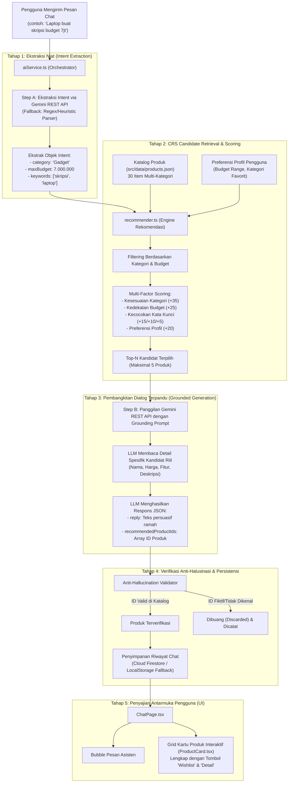
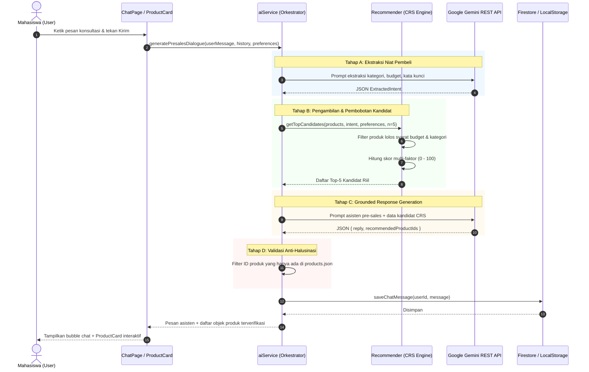

# Arsitektur Sistem: Asisten Pre-Sales E-Commerce (CRS + LLM)

Dokumen ini mendokumentasikan arsitektur sistem web asisten pre-sales e-commerce berbasis kolaborasi **Conversational Recommender System (CRS)** dan **Large Language Model (LLM)**, yang dirancang sesuai prinsip-prinsip dari paper penelitian:  
*“Conversational Recommender System and Large Language Model Are Made for Each Other in E-commerce Pre-sales Dialogue”*.

---

## 1. Ringkasan Konseptual

Dalam e-commerce konvensional, LLM murni sering mengalami **halusinasi produk** (merekomendasikan barang yang tidak ada di inventaris) atau **ketidakpatuhan filter** (memberi produk di luar batas anggaran/kategori pembeli). Sebaliknya, sistem rekomendasi murni (CRS) memiliki ketepatan matematis dalam menyaring katalog, namun tidak memiliki kemampuan komunikasi alami dan daya bujuk persuasif layaknya seorang staf *sales*.

Sistem ini memadukan keunggulan keduanya:
1. **Modul Rekomendasi (CRS)**: Bertindak sebagai *objective filter and ranker*. Memilih kandidat produk riil dari katalog lokal berdasarkan batasan anggaran, kategori, kata kunci, dan preferensi profil pengguna.
2. **Modul Bahasa (LLM - Google Gemini)**: Bertindak sebagai *persuasive communicator*. Menerima kandidat produk riil dari CRS, menyusun narasi persuasif yang ramah dan kontekstual, serta menjelaskan mengapa produk tersebut cocok untuk kebutuhan pembeli.
3. **Anti-Hallucination Barrier**: Lapisan validasi deterministik di *frontend/service layer* yang memverifikasi setiap ID produk yang dihasilkan LLM terhadap data katalog sebelum ditampilkan ke antarmuka pengguna.

---

## 2. Diagram Alur Kerja (Flowchart)

---

## 3. Diagram Interaksi Antar-Komponen (Sequence Diagram)

---

## 4. Rincian Modul dan Komponen Utama

### A. Modul Data (`src/data/products.json` & `src/types/index.ts`)
- **`Product`**: Struktur data produk yang seragam mencakup `id`, `name`, `category`, `price`, `description`, `tags`, dan `imageUrl`.
- **Dataset**: Berisi 30 produk representatif dunia mahasiswa (Gadget & Elektronik, Buku & Kuliah, Kos & Perlengkapan Kamar, Fashion & Busana, Transportasi & Aksesori, Makanan & Minuman Kemasan).

### B. Modul Mesin Rekomendasi (`src/services/recommender.ts`)
- **`filterProducts`**: Menyaring produk secara deterministik berdasarkan kecocokan kategori dan ambang batas anggaran maksimal (`maxBudget`).
- **`scoreProduct`**: Menghitung bobot relevansi berbasis multivariabel:
  - **Kategori Cocok**: +35 poin
  - **Kedekatan Anggaran (Budget Proximity)**: Hingga +25 poin jika harga produk mendekati batas anggaran pengguna (\(1 - \frac{\text{gap}}{\text{budget}}\))
  - **Pencocokan Kata Kunci**: +15 poin untuk kecocokan pada nama produk, +10 poin pada tagar produk, +5 poin pada deskripsi
  - **Personalisasi Profil**: +20 poin jika kategori produk terdaftar dalam kategori favorit profil pengguna
- **`getTopCandidates`**: Mengurutkan seluruh produk terfilter berdasarkan skor tertinggi dan mengembalikan \(N\) produk teratas (default: 5 kandidat).

### C. Modul Layanan AI (`src/services/aiService.ts`)
- **`extractIntent`**: Mengekstrak entitas niat pembeli dalam format JSON terstruktur via Gemini Flash. Jika koneksi API gagal atau dibatasi lajunya, sistem beralih otomatis ke *heuristic Indonesian regex parser* tanpa menghentikan aplikasi.
- **`generatePresalesDialogue`**: Menyusun prompt *grounded* yang memuat profil kandidat produk dari CRS. Menginstruksikan LLM untuk berperan sebagai konsultan pre-sales ramah, menyebutkan kelebihan produk secara faktual, dan melarang menyebutkan produk di luar daftar kandidat.
- **Anti-Hallucination Filtering**: Memastikan setiap elemen dalam `recommendedProductIds` lolos uji `catalogMap.has(id)`. ID fiktif langsung disaring keluar.

### D. Modul Antarmuka Pengguna (`src/pages/ChatPage.tsx` & `src/components/products/ProductCard.tsx`)
- **Visualisasi Transparan**: Menampilkan status mode (Grounded vs Baseline) dan chip indikator *intent* yang terdeteksi (kategori, batas harga, dan kata kunci).
- **Integrasi Produk Langsung**: Pesan asisten yang merekomendasikan produk langsung merender kartu produk interaktif di bawah gelembung obrolan, lengkap dengan format Rupiah Indonesia, tag kategori, tombol simpan ke Wishlist, dan tautan konsultasi.

### E. Modul Persistensi Ganda (`src/services/wishlist.service.ts` & `src/services/chat.service.ts`)
- **Cloud Firestore**: Menggunakan sub-koleksi hierarki `users/{userId}/wishlist/{productId}` dan `users/{userId}/chats/{chatId}/messages/{messageId}`.
- **Resilience Fallback**: Apabila kredensial Firebase belum dikonfigurasi dalam `.env.local` atau jaringan terputus, seluruh operasi CRUD beralih mulus ke `localStorage` sehingga penguji atau dosen dapat langsung menguji aplikasi secara offline tanpa hambatan instalasi.
